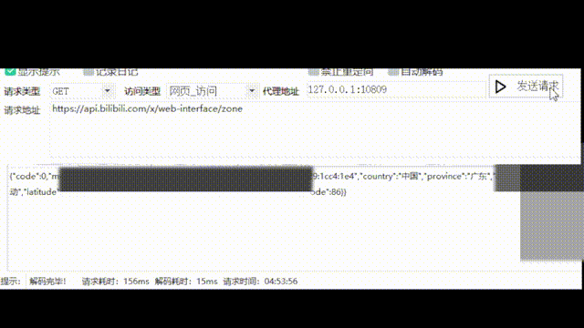

# ipv6-proxy-pool

一个只出 IPv6 的 SOCKS5 代理：每个连接从地址池中选择一个 IPv6 地址作为出口，可以顺序轮换、随机，或按用户名/密码锁定 IP。

支持 Linux 和 Windows（`anyipv6` 模式仅 Linux）。仅供学习参考。

| 系统 | 架构 |
| --- | --- |
| Linux | amd64、arm64、armv7、mipsle（softfloat，适用于 MT7621 等 OpenWrt 路由器） |
| Windows | amd64、arm64 |

Linux 版本为静态编译，不依赖 glibc，可在 Alpine、OpenWrt 等系统上直接运行。



## 特性

- 两种地址来源
  - `nic`：在网卡前缀内批量生成随机地址并添加到网卡
  - `anyipv6`：不添加地址，直接使用整个前缀（freebind），地址池等于整个前缀
- 三种选择方式：`sequential` 顺序、`random` 随机、`hash` 按凭据锁定 IP
- 支持任意前缀长度（/48、/56、/64、/112……），只要小于 128
- SOCKS5 无认证 / 用户名密码认证（RFC 1929）
- 可设置监听地址；可选 IPv4 兼容（IPv4 目标走系统默认出口）
- 自定义 hosts 文件，一个域名可对应多个地址，请求时随机选择
- 只在握手阶段设超时，长连接不会被断开；目标拨号有超时，域名解析结果有缓存
- Linux 下转发走 splice 零拷贝；有 iproute2 时用 `ip -batch` 批量增删地址

## 环境要求

- 网卡上至少有一个公网 IPv6 地址，且前缀长度小于 128（如 `2001:db8::1/64`）
- 修改网卡地址或路由需要 root / 管理员权限
- Linux 推荐安装 iproute2：`nic` 模式用 `ip -batch` 批量增删地址，新地址立即可用。BusyBox 的 `ip`（如 Alpine 默认自带的）或 `ifconfig` 也能用，但只能逐个执行，地址多时较慢，且新地址要等约 1 秒的重复地址检测（DAD）后才能作为出口。`anyipv6` 模式需要 `ip` 命令添加路由
- 默认只支持 IPv6 目标：IPv4 地址和只有 A 记录的域名会被拒绝，需要时可开启 [IPv4 兼容](#ipv4-兼容-ipv4)

## 快速开始

1. 从 [Releases](https://github.com/stmtc233/ipv6-proxy-pool/releases) 下载对应平台的程序，或自行编译：
   ```bash
   CGO_ENABLED=0 go build -trimpath -ldflags "-s -w" -o ipv6proxypool .
   ```
   查看版本：`./ipv6proxypool --version`
2. 编辑 `config.ini`，至少改好网卡名 `Networkname`。程序从**当前工作目录**读取 `config.ini` 和 `hosts`，请先 `cd` 到程序所在目录再运行（用 systemd 等启动时设置 `WorkingDirectory`）
3. 以 root / 管理员身份运行，按提示操作：
   ```bash
   sudo ./ipv6proxypool
   ```
4. 测试：
   ```bash
   curl -x socks5h://127.0.0.1:1080 https://api64.ipify.org
   ```
   多请求几次，`nic` / `anyipv6` 配合 `sequential` 或 `random` 时每次出口 IP 都不同。

## 配置

```ini
Networkname = eth0    ; 网卡名（Windows 填网络连接名称，如 以太网）
port = 1080           ; 监听端口
listen = 0.0.0.0      ; 监听地址

mode = nic            ; 地址来源：nic | anyipv6
select = sequential   ; 选择方式：sequential | random | hash
prefix =              ; anyipv6 使用的前缀，如 2001:db8::/48；留空则从网卡获取
ipv4 = off            ; IPv4 兼容：off | on
hosts = hosts         ; 自定义域名解析文件
```

除 `Networkname` 和 `port` 外的项不写时使用默认值。`anyipv6` 模式下填写了 `prefix` 时可以不填 `Networkname`。

### 监听地址 `listen`

| 写法 | 效果 |
| --- | --- |
| `0.0.0.0`（默认） | 所有 IPv4 地址，端口取 `port` |
| `::` | 所有 IPv4 和 IPv6 地址（双栈），端口取 `port` |
| `127.0.0.1` | 只允许本机访问 |
| `[::]:1080`、`127.0.0.1:1090` | 完整的 `host:port`，此时可以不填 `port` |

## 地址来源 `mode`

### `nic`（默认）

启动时依次询问：

1. **是否删除前缀地址以外的地址**：删除网卡上之前添加的 /128 地址，保留前缀长度小于 128 的原有地址
2. **是否添加地址以及数量**：在第一个前缀地址所在的前缀内生成不重复的随机地址，以 /128 添加到网卡。前缀太小时（如 /120 只有 256 个）只添加剩余可用的数量

之后网卡上所有公网 IPv6 地址组成出口池。

> __删除操作会移除网卡上的 /128 公网地址，执行前请确认没有其他用途。__

### `anyipv6`（仅 Linux）

不往网卡添加任何地址，每次连接直接绑定前缀内的任意地址作为出口，整个前缀都是地址池。

- 前缀优先使用 `prefix`，留空则取网卡上第一个前缀长度小于 128 的地址所在前缀
- 启动时可选择执行 `ip -6 route replace local <前缀> dev lo`，没有这条路由回包无法被本机接收
- **上游必须把这个前缀路由到本机**。如果前缀是 on-link 的（上游通过邻居发现逐个找地址，常见于只给一个 /64 的 VPS），还需要 [ndppd](https://github.com/DanielAdolfsson/ndppd) 之类的 NDP 代理
- 如果网关地址就在这个前缀内，添加 local 路由会导致网络不通。这种情况请改用 `nic` 模式，或者用 `prefix` 指定一个不包含网关的更小子网

## 选择方式 `select`

| 值 | 说明 |
| --- | --- |
| `sequential`（默认） | 按顺序轮流使用 |
| `random` | 每个连接随机选择 |
| `hash` | 根据 SOCKS5 用户名和密码计算出口，相同凭据总是同一个 IP |

`hash` 说明：

- 客户端**必须**使用用户名/密码认证，凭据不做校验，可以任意填写，例如用不同用户名区分会话：
  ```bash
  curl -x socks5h://user1:x@127.0.0.1:1080 https://api64.ipify.org   # 每次都是同一个 IP
  curl -x socks5h://user2:x@127.0.0.1:1080 https://api64.ipify.org   # 另一个固定 IP
  ```
- `anyipv6` 模式下只要前缀不变，对应关系就固定；`nic` 模式下网卡地址数量变化后对应关系会改变

## IPv4 兼容 `ipv4`

| 值 | 说明 |
| --- | --- |
| `off`（默认） | 拒绝 IPv4 目标，返回"地址类型不支持"；只有 A 记录的域名返回"主机不可达" |
| `on` | 允许 IPv4 目标 |

开启后的规则：

- 域名有 AAAA 记录时**始终**使用 IPv6，经过地址池
- IPv4 地址，以及只有 A 记录的域名，走系统默认的 IPv4 出口
- 地址池只有 IPv6，IPv4 流量**不会轮换出口 IP**，所有 IPv4 请求都是本机的 IPv4 地址

## hosts 文件 `hosts`

默认读取当前工作目录（与 `config.ini` 相同）下的 `hosts` 文件，不存在时跳过；用 `hosts = 路径` 指定其他文件（指定的文件不存在会报错）。只在启动时读取，修改后需要重启。

```text
# 地址[,地址...] 域名 [域名...]
2001:db8::1,2001:db8::2 example.com
2001:db8::3 example.org www.example.org
```

- 每行一条，`#` 之后为注释；地址之间用英文逗号分隔，地址与域名之间用空格分隔
- 一个域名对应多个地址时，**每次请求随机选择一个**；连接失败时依次尝试其余地址
- 同一域名可以写在多行，地址会合并；域名不区分大小写
- 解析顺序：IP 字面量 > hosts 文件 > DNS。匹配到 hosts 后不再查询 DNS
- 也可以写 IPv4 地址，只在 `ipv4 = on` 时生效；同一域名同时有 IPv6 和 IPv4 地址时只用 IPv6
- 文件格式错误时启动失败，并提示出错的行号

## 高并发

实测数据：4 核容器，代理、压测客户端和目标都在同一台机器上（IPv4 回环），数据仅供量级参考：

| 场景 | 结果 |
| --- | --- |
| 短连接（握手、往返 1 字节、关闭） | 约 1.07 万连接/秒，代理占用约 1.8 核，其中约 70% 是内核 TCP 开销 |
| 下载吞吐（8 个连接） | 约 19 Gbit/s，代理占用约 1.2 核（splice 零拷贝） |
| 空闲连接 | 每个连接：代理进程内存约 16.5 KiB、6 个 fd；内核另占约 40 KiB（splice 管道约 34 KiB，socket 约 7 KiB） |

需要调整的系统参数：

- **文件描述符**：每个连接占 6 个 fd（2 个 socket，加上 splice 每个方向一对管道）。Go 启动时会自动把软限制提到硬限制，需要调大的是硬限制，如 systemd 的 `LimitNOFILE=1048576`
- **conntrack**：防火墙开启连接跟踪时每个连接占 2 条记录，表满后直接丢包。调大 `net.netfilter.nf_conntrack_max`，或对代理流量设置 notrack
- **出站端口**：拨号时设置了 `IP_BIND_ADDRESS_NO_PORT`，端口在连接时按四元组分配，同一出口 IP 连接不同目标可以复用端口。短连接多时开启 `net.ipv4.tcp_tw_reuse = 1`（对 IPv6 同样生效）复用 TIME_WAIT
- **其他**：`net.core.somaxconn`（Go 的监听队列长度取这个值）、`net.ipv4.tcp_mem` 等
- **地址池很大时用 `anyipv6`**：网卡上的地址太多会增加内核开销（每个地址都有本地路由、组播组和邻居发现）

压测工具在 `tools/bench`，默认在 `[::1]:9000` 启动内置目标服务，经代理连接它：

```bash
go build -o bench ./tools/bench
./bench -mode conn -c 64 -d 10s                            # 新建连接速率和延迟
./bench -mode bulk -c 8 -d 10s                             # 下载吞吐量
./bench -mode idle -c 10000 -pid $(pidof ipv6proxypool)    # 每个连接的内存和 fd 开销（Linux）
```

`hash` 模式需要加 `-user`；目标放在另一台机器上更接近真实情况，见 `./bench -h`。

## 注意

- 代理没有访问控制，默认监听 0.0.0.0，请用防火墙限制来源，或把 `listen` 设为 `127.0.0.1`，避免成为公开代理
- 只支持 TCP CONNECT，不支持 UDP ASSOCIATE 和 BIND
